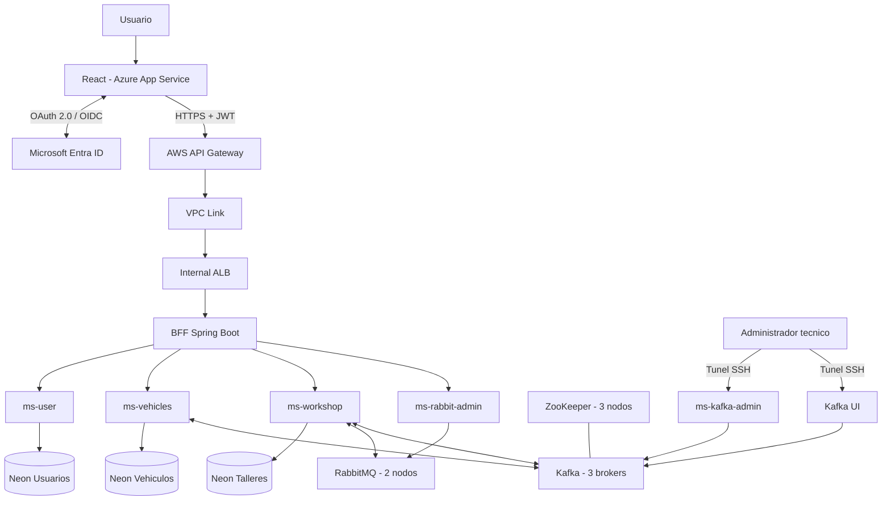
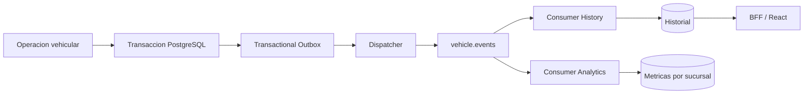
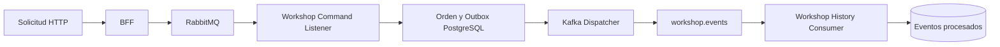

# Arquitectura Salfa360 - EP3 / EP5 / EP6

## 1. Contexto

Salfa360 es una plataforma de gestion operacional de
vehiculos usados, usuarios y talleres.

El proyecto evoluciona desde una arquitectura de
microservicios REST hacia una arquitectura orientada
a eventos, incorporando RabbitMQ y Apache Kafka.

## 2. Tecnologias

- Java 25.
- Spring Boot.
- Gradle.
- React y Vite.
- Microsoft Entra ID y MSAL.
- OAuth 2.0, OpenID Connect y JWT.
- AWS API Gateway.
- AWS VPC Link e Internal Application Load Balancer.
- Amazon EC2.
- Azure App Service.
- PostgreSQL en Neon.
- Docker Compose.
- RabbitMQ.
- Apache Kafka y ZooKeeper.
- Kafka UI.
- GitHub y GitHub Actions.

## 3. Arquitectura general

## 4. Microservicios

| Componente | Responsabilidad |
|---|---|
| bff | Seguridad y orquestacion REST |
| ms-user | Gestion de usuarios |
| ms-vehicles | Gestion de vehiculos, historial y analitica |
| ms-workshop | Talleres, ordenes y procesamiento asincrono |
| ms-rabbit-admin | Administracion de RabbitMQ |
| ms-kafka-admin | Administracion de topicos y grupos Kafka |

Cada componente backend dispone de su propio proyecto Gradle.

## 5. Seguridad

El frontend autentica usuarios mediante Microsoft Entra ID.

Las solicitudes utilizan access tokens JWT.

API Gateway valida el token antes de reenviar las
solicitudes al BFF mediante VPC Link e Internal ALB.

El BFF aplica sus controles de autenticacion y
autorizacion segun la configuracion del proyecto.

Los endpoints administrativos Kafka no se exponen
publicamente mediante API Gateway.

El administrador Kafka escucha exclusivamente en
loopback y se accede mediante tunel SSH.

## 6. RabbitMQ

RabbitMQ se utiliza para procesamiento de comandos
asincronos y distribucion de eventos operacionales.

El cluster cuenta con dos nodos.

### Exchanges

| Nombre | Tipo |
|---|---|
| salfa360.commands | direct |
| salfa360.events | topic |
| salfa360.dlx | direct |

### Colas

| Principal | DLQ |
|---|---|
| workshop.commands.q | workshop.commands.dlq |
| notification.events.q | notification.events.dlq |
| audit.events.q | audit.events.dlq |

Las colas son durables de tipo classic.

Se utilizan confirmaciones manuales e idempotencia
para el procesamiento de comandos.

## 7. Apache Kafka

El cluster Kafka se ejecuta mediante Docker Compose
en una instancia Amazon EC2.

Componentes:

- Tres nodos ZooKeeper.
- Tres brokers Kafka.
- Una instancia Kafka UI.
- Microservicio administrador independiente.

Los brokers son accesibles por red privada desde
los microservicios autorizados.

### Topicos

| Topico | Particiones | Replicas | Retencion |
|---|---:|---:|---:|
| vehicle.events | 3 | 3 | 7 dias |
| workshop.events | 3 | 3 | 14 dias |
| vehicle.events.dlq | 3 | 3 | 14 dias |
| workshop.events.dlq | 3 | 3 | 14 dias |

Configuracion:

- min.insync.replicas = 2.
- cleanup.policy = delete.
- acks = all.
- Productores idempotentes.
- Creacion automatica de topicos deshabilitada.
- Confirmacion manual de offsets.
- Factor de replicacion de consumer offsets igual a 3.

## 8. Caso de uso 1: historial y analitica vehicular

Las operaciones de creacion, actualizacion y
eliminacion de vehiculos generan eventos de negocio.

La operacion de negocio y el registro Outbox
se persisten dentro de una transaccion PostgreSQL.

Un dispatcher publica asincronamente el evento.

El VIN se utiliza como clave de particionamiento.

Los grupos son independientes:

- salfa360-vehicle-history.
- salfa360-vehicle-analytics.

History registra el historial del vehiculo.

Analytics agrega eventos por sucursal y tipo.

Las metricas representan cantidad de eventos
procesados, no cantidad de vehiculos en stock.

## 9. Caso de uso 2: ingreso a taller

RabbitMQ permite recibir un comando de creacion
asincrona de una orden de taller.

La orden se persiste en PostgreSQL y se registra
un evento en el Outbox de Workshop.

El dispatcher publica WORKSHOP_ORDER_CREATED
en workshop.events.

La clave Kafka corresponde al ID del vehiculo.

El grupo salfa360-workshop-history consume el
evento y registra su procesamiento de manera
idempotente.

## 10. Consistencia e idempotencia

Se utiliza Transactional Outbox para reducir el riesgo
de perder eventos entre la persistencia de negocio
y la publicacion asincrona.

Los consumidores registran identificadores unicos
de evento para evitar procesamiento duplicado.

Los offsets se confirman despues de completar
el procesamiento.

La entrega se disena con semantica at-least-once
e idempotencia en los consumidores.

No se afirma una garantia exactly-once distribuida.

## 11. Manejo de errores

Los consumidores validan estructura, identificadores,
version y clave del evento segun su contrato.

Los errores de procesamiento utilizan reintentos
acotados y topicos Dead Letter.

El dispatcher conserva el estado y los intentos
de publicacion dentro del Outbox.

Los mensajes invalidos pueden investigarse sin
bloquear permanentemente el procesamiento normal.

## 12. Administracion y monitoreo

Kafka UI permite consultar:

- Brokers.
- Topicos.
- Particiones.
- Replicas.
- ISR.
- Mensajes.
- Consumer groups.
- Offsets y lag.

ms-kafka-admin proporciona una API REST de
administracion utilizando Kafka AdminClient.

Las operaciones de escritura se restringen a
topicos administrativos con prefijo salfa360.admin.

El detalle de sus endpoints se encuentra en:

backend/ms-kafka-admin/README.md

## 13. Frontend reactivo

El perfil de vehiculo consulta su historial
automaticamente cada cinco segundos mediante polling.

No requiere que el usuario recargue manualmente
la pagina.

El perfil tambien consulta ordenes de taller.

La vista de talleres incorpora metricas operacionales.

## 14. Infraestructura reproducible

Archivos principales:

- infrastructure/kafka/compose-cluster.yaml
- infrastructure/kafka/compose-cloud.yaml
- infrastructure/kafka/scripts/create-topics.sh
- infrastructure/kafka/scripts/inspect-kafka.sh
- infrastructure/kafka/scripts/manage-kafka.sh
- infrastructure/rabbitmq/compose.yaml
- infrastructure/database/migrations/

Los valores propios de cada entorno se configuran
mediante variables y archivos externos al repositorio.

No se deben versionar contrasenas, tokens ni claves SSH.

## 15. Limitaciones y decisiones de arquitectura

La infraestructura fue dimensionada para un
entorno academico con presupuesto limitado.

Los tres brokers Kafka comparten una instancia EC2.
Existe redundancia entre brokers, pero no
tolerancia a la perdida de la instancia completa.

Los dos nodos RabbitMQ tambien comparten una EC2.
Las colas classic no proporcionan replicacion
automatica de mensajes entre nodos.

La comunicacion Kafka utiliza red privada y
no implementa cifrado TLS ni SASL en este entorno.

El administrador Kafka no implementa autenticacion
HTTP propia. Su acceso se restringe a loopback y SSH.

La proyeccion historica de Workshop registra
la creacion de ordenes. No comprende todos los
eventos de su ciclo de vida.

El repositorio se organiza como monorepo con
componentes independientes. No corresponde a una
separacion fisica en multiples repositorios.

## 16. Evidencias

Las pruebas locales y cloud se encuentran en:

- docs/evidencias/kafka/
- docs/evidencias/kafka-admin/
- docs/evidencias/rabbitmq/
- docs/evidencias/pruebas/
- docs/evidencias/seguridad/

Los resultados deben interpretarse de acuerdo con
las evidencias efectivamente obtenidas.
